# PRAKTIKUM 7
# PEMROGRAMAN SERVER-SIDE DENGAN PHP

## A. IDENTITAS MAHASISWA

| Keterangan | Identitas |
|---|---|
| Nama | [Anggun Kusuma Wardani] |
| NIM | [312510045] |
| Kelas | [I253A] |
| Dosen Pengampu | [Agung Nugroho, S.Kom., M.Kom., S.Kom., M. Kom] |
| Mata Kuliah | Pemrograman Web |
| Nomor Praktikum | 7 |
| Materi | Pemrograman Server-Side dengan PHP |

---

## B. TUJUAN PRAKTIKUM

Praktikum ini bertujuan untuk:

1. Memahami perbedaan pemrosesan client-side dan server-side.
2. Mengenali sintaks PHP dan menjalankan file PHP melalui server lokal.
3. Memahami penggunaan variabel, tipe data, operator, percabangan, perulangan, dan function.
4. Mempelajari cara menerima dan memproses data dari form HTML menggunakan metode GET dan POST.
5. Melakukan validasi dan sanitasi input sebelum data ditampilkan atau diproses.
6. Membuat aplikasi sederhana yang dapat menerima, memproses, dan menampilkan data pengguna.

## C. DASAR TEORI

### 1. Pengertian Server-Side

Server-side merupakan proses pengolahan data yang dilakukan di sisi server. Server menerima permintaan dari pengguna, memproses data, menjalankan aturan aplikasi, kemudian mengirimkan hasilnya kembali ke browser.

### 2. Pengertian PHP

PHP (Hypertext Preprocessor) merupakan bahasa pemrograman server-side yang digunakan untuk membangun aplikasi web dinamis. File PHP umumnya menggunakan ekstensi `.php` dan dijalankan melalui web server yang mendukung PHP.

### 3. Variabel PHP

Variabel PHP digunakan untuk menyimpan data dan ditandai dengan karakter `$` di awal nama variabel.

Contoh:
```php
$nama = "Anggun";
$umur = 20;
```

### 4. Form Handling

Form handling merupakan proses menerima dan mengolah data yang dikirimkan pengguna melalui formulir HTML. PHP menyediakan metode GET dan POST untuk menerima data tersebut.

### 5. Validasi dan Sanitasi

Validasi digunakan untuk memeriksa apakah data yang dimasukkan pengguna sudah sesuai dengan ketentuan. Sanitasi dilakukan untuk membantu mengamankan data sebelum ditampilkan atau diproses.

---

## D. PERANGKAT YANG DIGUNAKAN

1. Visual Studio Code sebagai editor kode program.
2. XAMPP sebagai server lokal untuk menjalankan PHP.
3. PHP sebagai bahasa pemrograman server-side.
4. Google Chrome atau Microsoft Edge sebagai browser untuk menampilkan hasil program.
5. Sistem operasi Windows sebagai lingkungan pengerjaan praktikum.

---

## E. STRUKTUR FILE

Seluruh file praktikum disimpan dalam satu folder bernama `Lab7Web_PHP`.

Struktur folder yang digunakan:

```text
Lab7Web_PHP/
│
├── index.php
│
├── latihan2.php
├── latihan3.php
├── latihan4.php
├── latihan5.php
├── latihan6.php
├── latihan7.php
│
├── MiniProject.php
│
├── eksperimen1.php
├── eksperimen2.php
├── eksperimen3.php
├── eksperimen4.php
├── eksperimen5.php
│
├── README.md
│
└── Screenshot/
    ├── latihan1.png
    ├── latihan2.png
    ├── latihan3.png
    ├── latihan4.png
    ├── latihan5.png
    ├── latihan6.png
    ├── latihan7.png
    ├── miniproject.png
    ├── eksperimen1.png
    ├── eksperimen2.png
    ├── eksperimen3.png
    ├── eksperimen4.png
    └── eksperimen5.png
```

Keterangan:
- `index.php` merupakan file untuk latihan 1.
- `latihan2.php` sampai `latihan7.php` merupakan file untuk latihan 2 sampai latihan 7.
- `mahasiswa.php` merupakan file mini project formulir data mahasiswa.
- `eksperimen1.php` sampai `eksperimen5.php` merupakan file eksperimen mandiri.
- `Screenshot/` merupakan folder untuk menyimpan dokumentasi hasil pengerjaan.
- `README.md` berisi dokumentasi keseluruhan praktikum.

---

## F. CARA MENJALANKAN PROGRAM

Berikut langkah-langkah untuk menjalankan program PHP:

1. Pastikan aplikasi XAMPP sudah terinstal pada komputer.
2. Buka aplikasi XAMPP Control Panel.
3. Aktifkan Apache dengan menekan tombol Start.
4. Buat folder proyek bernama `Lab7Web_PHP` di dalam direktori `C:\xampp\htdocs`.
5. Buka folder tersebut menggunakan Visual Studio Code.
6. Buat seluruh file PHP sesuai dengan struktur folder.
7. Masukkan kode program ke masing-masing file.
8. Simpan seluruh file dengan menekan `Ctrl + S`.
9. Buka browser Google Chrome atau Microsoft Edge.
10. Jalankan program melalui alamat localhost.

Contoh alamat untuk membuka program:

```text
http://localhost/Lab7Web_PHP/
```

Untuk menjalankan file lainnya, gunakan alamat:

```text
http://localhost/Lab7Web_PHP/latihan2.php
http://localhost/Lab7Web_PHP/latihan3.php
http://localhost/Lab7Web_PHP/latihan4.php
http://localhost/Lab7Web_PHP/latihan5.php
http://localhost/Lab7Web_PHP/latihan6.php
http://localhost/Lab7Web_PHP/latihan7.php
http://localhost/Lab7Web_PHP/mahasiswa.php
```

---

## G. LANGKAH KERJA PRAKTIKUM

### 1. Latihan 1 – Menjalankan PHP

Pada latihan pertama dibuat file `index.php` untuk mencoba menjalankan kode PHP melalui server lokal.

Program menggunakan perintah `echo` untuk menampilkan tulisan dan fungsi `date()` untuk menampilkan waktu server.

Hasil yang diharapkan:
- Judul halaman: Belajar PHP.
- Tulisan: PHP berhasil dijalankan.
- Waktu server ditampilkan pada halaman browser.

### 2. Latihan 2 – Variabel, Operator, dan Percabangan

Pada latihan kedua dibuat program untuk menghitung nilai akhir mahasiswa berdasarkan nilai tugas, UTS, dan UAS.

Bobot penilaian yang digunakan:
- Tugas: 30%.
- UTS: 30%.
- UAS: 40%.

Program menggunakan operator matematika serta percabangan `if`, `elseif`, dan `else` untuk menentukan predikat mahasiswa.

Contoh hasil:
- Nama: Anggun.
- Nilai akhir: 92.60.
- Predikat: A.

### 3. Latihan 3 – Perulangan dan Array

Pada latihan ketiga dibuat program untuk menyimpan dan menampilkan daftar nama mahasiswa menggunakan array dan perulangan `foreach`.

Nama mahasiswa disimpan dalam satu variabel array, kemudian ditampilkan satu per satu dalam bentuk daftar bernomor.

Contoh hasil:
1. Anggun
2. Kensha
3. Marisha
4. Nabila

### 4. Latihan 4 – Membuat Function

Pada latihan keempat dibuat function untuk menghitung harga setelah mendapatkan diskon.

Function `hitungDiskon()` menerima parameter harga awal dan persentase diskon, kemudian menghitung potongan harga dan harga akhir.

Contoh hasil:
- Harga awal: Rp150.000.
- Diskon: 10%.
- Potongan harga: Rp15.000.
- Harga setelah diskon: Rp135.000.

### 5. Latihan 5 – Memproses Form dengan GET

Pada latihan kelima dibuat formulir pencarian menggunakan metode GET.

Data yang dimasukkan pengguna dikirim melalui parameter URL dan diambil menggunakan variabel superglobal `$_GET`.

Program menggunakan `isset()`, `trim()`, dan `htmlspecialchars()` untuk memeriksa, membersihkan, serta mengamankan tampilan data.

Contoh hasil:
- Kata kunci yang dimasukkan: Bekasi.
- Kata kunci: Bekasi.

### 6. Latihan 6 – Memproses Form dengan POST

Pada latihan keenam dibuat formulir yang menerima nama dan program studi mahasiswa.

Data dikirim menggunakan metode POST dan diproses menggunakan variabel superglobal `$_POST`.

Program melakukan pemeriksaan untuk memastikan semua kolom sudah diisi sebelum menampilkan data.

Contoh hasil:
- Nama: Anggun Kusuma.
- Program Studi: Teknik Informatika.
- Status: Data diterima.

### 7. Latihan 7 – Pengolahan Data Sederhana

Pada latihan ketujuh dibuat program untuk mengolah data transaksi sederhana yang terdiri dari nama barang, harga, dan jumlah barang.

Program menghitung subtotal menggunakan rumus:

**Subtotal = Harga × Jumlah**

Contoh hasil:
- Nama barang: Baju.
- Harga: Rp55.000.
- Jumlah: 5.
- Subtotal: Rp275.000.

Program juga melakukan validasi agar data yang dimasukkan sesuai dengan ketentuan.

---

## H. MINI PROJECT – APLIKASI FORMULIR DATA MAHASISWA

Pada bagian mini project dibuat aplikasi formulir data mahasiswa yang dapat menerima dan menampilkan informasi mahasiswa melalui form HTML.

Formulir terdiri dari lima kolom, yaitu:

1. Nama mahasiswa.
2. NIM.
3. Program studi.
4. Semester.
5. Email.

Ketentuan pemrosesan:
- Menggunakan metode POST.
- Semua kolom wajib diisi.
- Semester harus berupa bilangan bulat antara 1 sampai 14.
- Email harus memiliki format yang valid.
- Data yang ditampilkan menggunakan `htmlspecialchars()`.

Hasil yang diharapkan:

Apabila semua data valid, aplikasi menampilkan ringkasan data mahasiswa.

Apabila terdapat data yang tidak sesuai, aplikasi menampilkan pesan kesalahan berdasarkan hasil validasi.

Contoh pengujian:

**Data valid:**
- Nama: Anggun Kusuma.
- NIM: 123456.
- Program Studi: Teknik Informatika.
- Semester: 3.
- Email: angggun@gmail.com.

**Data tidak valid:**
- Semester: 20.
- Email: anggunmail.

Hasil pengujian menunjukkan bahwa program dapat menerima data yang sesuai dan memberikan pesan kesalahan apabila terdapat input yang tidak memenuhi ketentuan.

---

## I. EKSPERIMEN MANDIRI

### 1. Eksperimen 1 – Menghitung Nilai Rata-Rata

Eksperimen pertama dilakukan dengan membuat program untuk menghitung nilai rata-rata dari tiga komponen, yaitu tugas, UTS, dan UAS.

Program menggunakan operator penjumlahan dan pembagian untuk memperoleh nilai rata-rata.

Contoh:
- Nilai tugas: 92.
- Nilai UTS: 90.
- Nilai UAS: 95.
- Nilai rata-rata: 92.33.

Rumus:

Rata-rata = (Tugas + UTS + UAS) / 3.

### 2. Eksperimen 2 – Pencarian Nama Menggunakan GET

Eksperimen kedua dilakukan dengan membuat fitur pencarian nama mahasiswa menggunakan metode GET.

Data nama mahasiswa disimpan dalam array. Ketika pengguna memasukkan kata kunci, program mencari nama yang sesuai menggunakan `foreach()` dan `stripos()`.

Hasil yang diharapkan adalah menampilkan nama mahasiswa yang cocok dengan kata kunci pencarian. Jika tidak ditemukan, program menampilkan pesan bahwa nama mahasiswa tidak ditemukan.

### 3. Eksperimen 3 – Function Format Rupiah

Eksperimen ketiga dilakukan dengan membuat function bernama `formatRupiah()` untuk mengubah angka menjadi format mata uang Rupiah.

Program menggunakan `number_format()` untuk mengatur pemisah ribuan.

Contoh hasil:
- 150000 menjadi Rp150.000.
- 250000 menjadi Rp250.000.
- 75000 menjadi Rp75.000.

### 4. Eksperimen 4 – Validasi NIM

Eksperimen keempat dilakukan dengan menambahkan validasi agar NIM hanya berisi angka dan memiliki panjang sesuai ketentuan.

Pada program ini ditetapkan bahwa NIM harus terdiri dari 10 digit angka.

Validasi menggunakan:
- `ctype_digit()` untuk memeriksa karakter angka.
- `strlen()` untuk menghitung panjang NIM.
- `if` dan `elseif` untuk menentukan hasil validasi.

Hasil yang diharapkan:
- NIM 1234567890 dinyatakan valid.
- NIM yang kurang dari 10 digit dinyatakan tidak valid.
- NIM yang mengandung huruf dinyatakan tidak valid.

### 5. Eksperimen 5 – Tombol Reset pada Form

Eksperimen kelima dilakukan dengan menambahkan tombol Reset pada formulir HTML.

Tombol Reset menggunakan atribut `type="reset"` untuk mengembalikan isian formulir ke kondisi awal tanpa mengirim data ke server.

Sementara itu, tombol Submit digunakan untuk mengirim data melalui metode POST agar dapat diproses oleh PHP.

Hasil yang diharapkan:
- Tombol Reset mengosongkan kembali kolom input.
- Tombol Kirim Data mengirimkan data ke server.
- PHP menampilkan data yang telah dikirimkan.

---

## J. DOKUMENTASI SCREENSHOT HASIL PRAKTIKUM

Dokumentasi berikut merupakan hasil pengerjaan Praktikum 7 mengenai Pemrograman Server-Side dengan PHP. Setiap screenshot menunjukkan hasil program yang telah dijalankan melalui server lokal XAMPP menggunakan browser.

### 1. Latihan 1 – Menjalankan PHP

Pada latihan pertama dilakukan pengujian untuk memastikan bahwa kode PHP dapat dijalankan melalui server lokal. Program menggunakan perintah `echo` untuk menampilkan tulisan dan fungsi `date()` untuk menampilkan waktu server.

**Hasil yang diperoleh:** Halaman browser berhasil menampilkan judul "Belajar PHP", tulisan "PHP berhasil dijalankan", serta informasi waktu server.

**Screenshot:**

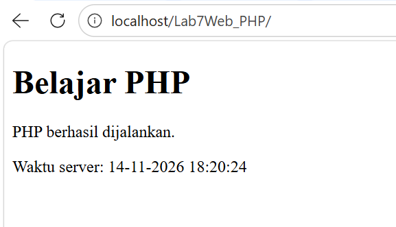

### 2. Latihan 2 – Variabel, Operator, dan Percabangan

Pada latihan kedua dibuat program untuk menghitung nilai akhir mahasiswa berdasarkan nilai tugas, UTS, dan UAS. Perhitungan dilakukan menggunakan operator matematika, sedangkan penentuan predikat menggunakan percabangan `if`, `elseif`, dan `else`.

**Hasil yang diperoleh:** Program menampilkan nama mahasiswa, nilai akhir sebesar 92.60, dan predikat A.

**Screenshot:**

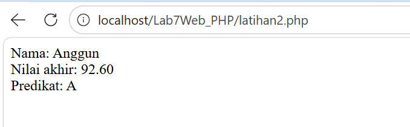

### 3. Latihan 3 – Perulangan dan Array

Pada latihan ketiga dibuat program untuk menyimpan beberapa nama mahasiswa dalam array. Data tersebut kemudian ditampilkan menggunakan perulangan `foreach` sehingga seluruh nama dapat ditampilkan secara berurutan.

**Hasil yang diperoleh:** Browser menampilkan daftar nama mahasiswa, yaitu Anggun, Kensha, Marisha, dan Nabila dalam bentuk daftar bernomor.

**Screenshot:**

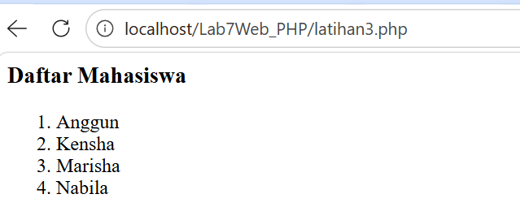

### 4. Latihan 4 – Membuat Function

Pada latihan keempat dibuat function bernama `hitungDiskon()` yang digunakan untuk menghitung harga setelah mendapatkan potongan diskon. Program menerima harga awal dan persentase diskon sebagai parameter.

**Hasil yang diperoleh:**
- Harga awal: Rp150.000.
- Diskon: 10%.
- Potongan harga: Rp15.000.
- Harga setelah diskon: Rp135.000.

**Screenshot:**

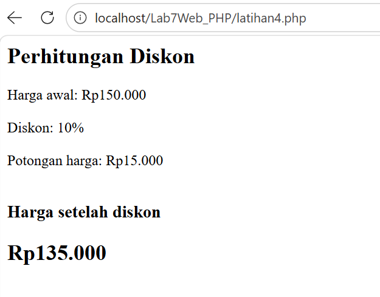

### 5. Latihan 5 – Memproses Form dengan GET

Pada latihan kelima dibuat formulir pencarian sederhana menggunakan metode GET. Data yang dimasukkan pengguna dikirim melalui parameter URL dan diambil menggunakan variabel superglobal `$_GET`.

**Hasil yang diperoleh:** Setelah pengguna memasukkan kata kunci dan menekan tombol Cari, program menampilkan kembali kata kunci yang dimasukkan. Data juga terlihat pada parameter URL browser.

**Screenshot:**

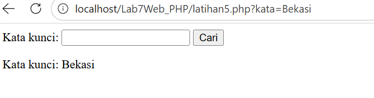

### 6. Latihan 6 – Memproses Form dengan POST

Pada latihan keenam dibuat formulir untuk menerima data nama dan program studi mahasiswa menggunakan metode POST. Data yang dikirim kemudian diperiksa dan ditampilkan kembali oleh PHP.

**Hasil yang diperoleh:** Program berhasil menerima data mahasiswa dan menampilkan nama serta program studi setelah tombol Kirim Data ditekan.

**Screenshot:**

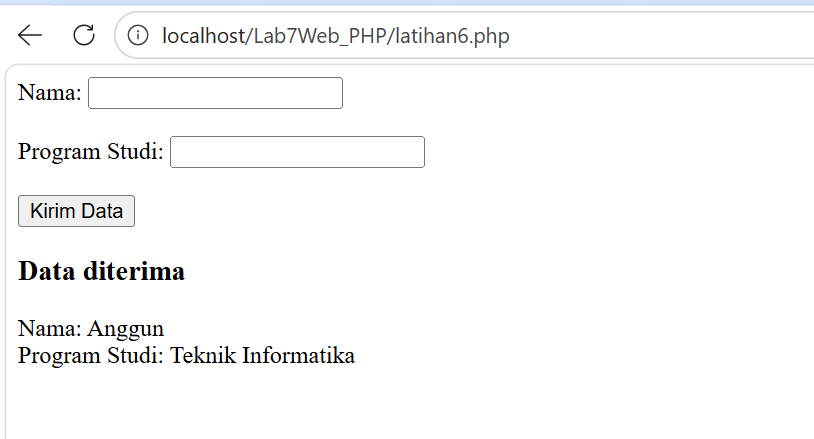

### 7. Latihan 7 – Pengolahan Data Sederhana

Pada latihan ketujuh dibuat program pengolahan data transaksi sederhana yang menerima nama barang, harga, dan jumlah barang. Program melakukan validasi input dan menghitung subtotal menggunakan operasi perkalian.

**Hasil yang diperoleh:** Program menampilkan nama barang dan subtotal transaksi berdasarkan harga dan jumlah barang yang dimasukkan.

Contoh perhitungan:
- Nama barang: Baju.
- Harga: Rp55.000.
- Jumlah: 5.
- Subtotal: Rp275.000.

**Screenshot:**

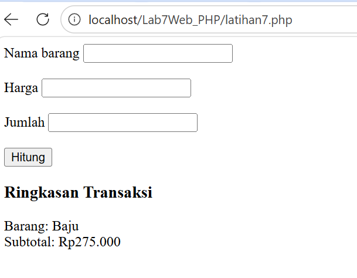

### 8. Mini Project – Aplikasi Formulir Data Mahasiswa

Pada mini project dibuat aplikasi formulir data mahasiswa yang terdiri dari nama, NIM, program studi, semester, dan email. Data dikirim menggunakan metode POST dan diperiksa melalui proses validasi di sisi server.

**Hasil yang diperoleh:** Program berhasil menerima data mahasiswa dan menampilkan ringkasan data apabila seluruh input memenuhi ketentuan yang telah ditetapkan.

**Screenshot:**

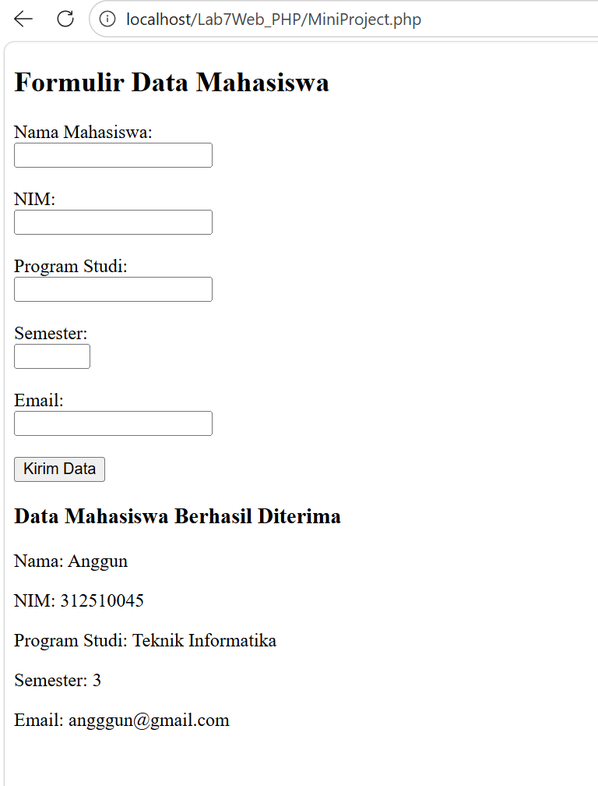

### 9. Eksperimen Mandiri 1 – Menghitung Nilai Rata-Rata

Pada eksperimen pertama dibuat program untuk menghitung nilai rata-rata dari tiga komponen, yaitu nilai tugas, UTS, dan UAS. Perhitungan menggunakan operator penjumlahan dan pembagian.

**Hasil yang diperoleh:** Program menghasilkan nilai rata-rata sebesar 92.33 dari nilai tugas 92, UTS 90, dan UAS 95.

**Screenshot:**

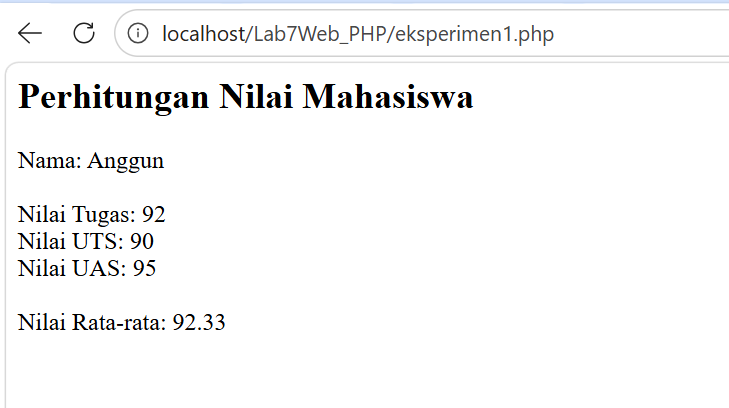

### 10. Eksperimen Mandiri 2 – Pencarian Nama Menggunakan GET

Pada eksperimen kedua dibuat fitur pencarian nama mahasiswa berdasarkan data yang tersimpan di dalam array. Program menggunakan metode GET untuk menerima kata kunci dan `foreach` serta `stripos()` untuk mencari nama yang sesuai.

**Hasil yang diperoleh:** Program dapat menampilkan nama mahasiswa yang sesuai dengan kata kunci pencarian. Jika nama tidak ditemukan, program menampilkan pesan bahwa nama mahasiswa tidak tersedia.

**Screenshot:**

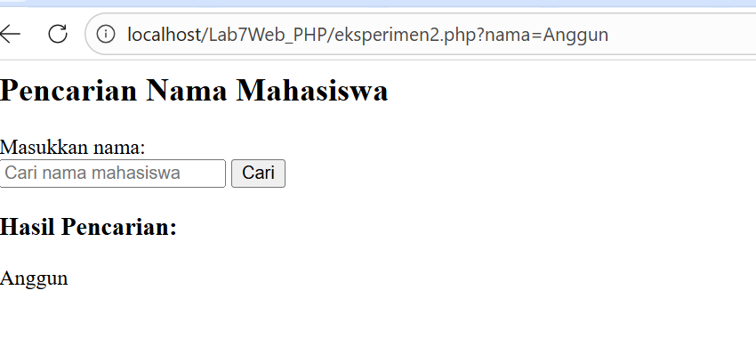

### 11. Eksperimen Mandiri 3 – Function Format Rupiah

Pada eksperimen ketiga dibuat function `formatRupiah()` untuk mengubah angka menjadi format mata uang Rupiah. Program menggunakan fungsi `number_format()` untuk mengatur pemisah ribuan.

**Hasil yang diperoleh:** Program berhasil menampilkan beberapa nilai harga dalam format Rupiah, seperti Rp150.000, Rp250.000, dan Rp75.000.

**Screenshot:**

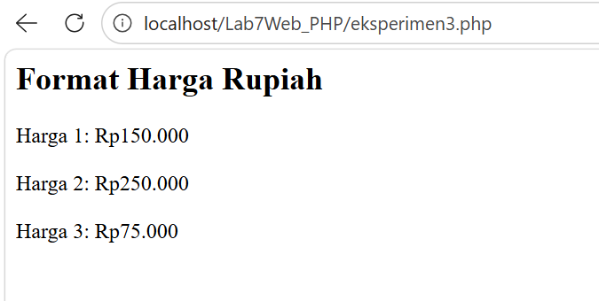

### 12. Eksperimen Mandiri 4 – Validasi NIM

Pada eksperimen keempat dibuat program untuk memvalidasi NIM mahasiswa agar hanya terdiri dari angka dan memiliki panjang tepat 10 digit sesuai ketentuan contoh program.

**Hasil yang diperoleh:** Program menerima NIM yang terdiri dari 10 digit angka dan menampilkan pesan kesalahan apabila NIM mengandung huruf atau memiliki jumlah digit yang tidak sesuai..

**Screenshot:**

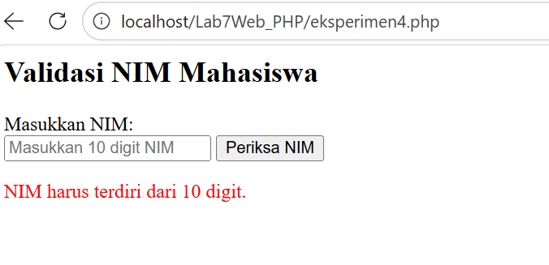

### 13. Eksperimen Mandiri 5 – Tombol Reset pada Form

Pada eksperimen kelima dibuat formulir yang memiliki tombol Kirim Data dan Reset. Tombol Reset digunakan untuk mengembalikan kolom input ke kondisi awal, sedangkan tombol Kirim Data digunakan untuk mengirim data ke server melalui metode POST.

**Hasil yang diperoleh:** Tombol Reset berhasil mengosongkan kolom formulir, sedangkan tombol Kirim Data berhasil mengirimkan data dan menampilkan hasil pemrosesan PHP.

**Screenshot:**

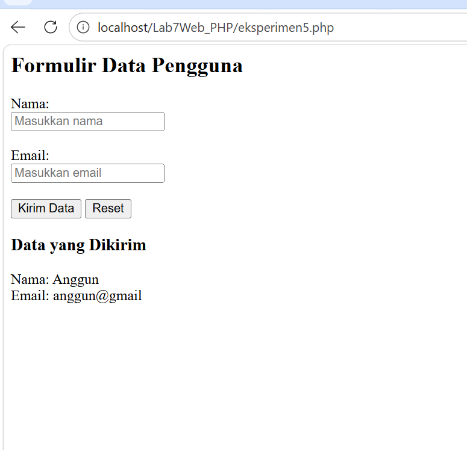

### Kesimpulan Dokumentasi

Berdasarkan dokumentasi hasil praktikum, seluruh latihan, mini project, dan eksperimen mandiri dirancang untuk menerapkan konsep dasar pemrograman server-side menggunakan PHP. Setiap program menunjukkan penggunaan sintaks PHP, pengolahan data, pemrosesan formulir, validasi input, serta pembuatan function dalam aplikasi web sederhana.
---

## K. PERTANYAAN EVALUASI

### 1. Apa perbedaan pemrosesan client-side dan server-side?

Client-side merupakan proses yang dilakukan di sisi browser pengguna, misalnya menggunakan HTML, CSS, dan JavaScript. Sementara itu, server-side merupakan proses yang dilakukan di server untuk menerima permintaan, memproses data, menjalankan aturan aplikasi, dan mengirimkan respons kembali ke browser.

### 2. Mengapa file PHP harus dijalankan melalui web server?

Karena PHP merupakan bahasa pemrograman server-side yang membutuhkan web server untuk menjalankan dan memproses kode PHP. Hasil pemrosesan tersebut kemudian dikirimkan ke browser dalam bentuk output seperti HTML.

### 3. Apa fungsi tanda $ pada variabel PHP?

Tanda `$` digunakan sebagai penanda awal nama variabel dalam PHP. Setiap variabel PHP harus diawali dengan tanda tersebut agar dapat dikenali oleh interpreter PHP.

Contoh:
```php
$nama = "Anggun";
$umur = 20;
```

### 4. Apa perbedaan metode GET dan POST?

GET mengirimkan data melalui parameter URL sehingga data dapat terlihat pada alamat browser. POST mengirimkan data melalui body request HTTP sehingga data tidak ditampilkan langsung pada URL.

GET biasanya digunakan untuk pencarian atau permintaan data, sedangkan POST umum digunakan untuk pengiriman formulir.

### 5. Mengapa input pengguna perlu divalidasi di sisi server?

Validasi di sisi server diperlukan untuk memastikan data yang diterima sesuai dengan ketentuan program. Validasi juga membantu mencegah data kosong, data yang tidak sesuai format, serta mengurangi kesalahan dalam pemrosesan aplikasi.

### 6. Apa fungsi htmlspecialchars() ketika menampilkan data dari form?

`htmlspecialchars()` digunakan untuk mengubah karakter khusus HTML menjadi HTML entities sehingga input pengguna ditampilkan sebagai teks dan tidak langsung ditafsirkan sebagai kode HTML atau script oleh browser. Fungsi ini membantu mengurangi risiko injeksi HTML dan script.

### 7. Apa manfaat penggunaan function dalam program PHP?

Function bermanfaat untuk membuat program lebih terstruktur, mengurangi penulisan kode yang berulang, mempermudah pemeliharaan program, serta memungkinkan suatu proses digunakan kembali dengan parameter yang berbeda.

---

## L. KESIMPULAN

Berdasarkan Praktikum 7 mengenai Pemrograman Server-Side dengan PHP, dapat disimpulkan bahwa PHP merupakan bahasa pemrograman yang digunakan untuk mengolah data pada sisi server. Melalui praktikum ini, mahasiswa mempelajari dasar-dasar pemrograman PHP, mulai dari penggunaan sintaks, variabel, tipe data, operator, percabangan, perulangan, array, hingga function.

Selain itu, mahasiswa juga memahami proses pengiriman dan pengolahan data melalui formulir HTML menggunakan metode GET dan POST. Penggunaan validasi dan sanitasi input menjadi bagian penting untuk memastikan data yang diterima sesuai dengan ketentuan serta ditampilkan dengan lebih aman.

Melalui tujuh latihan, mini project formulir data mahasiswa, dan lima eksperimen mandiri, mahasiswa dapat menerapkan konsep PHP untuk membuat aplikasi web sederhana yang mampu menerima, memproses, menghitung, memvalidasi, serta menampilkan data pengguna.

Dengan demikian, praktikum ini memberikan pemahaman dan pengalaman dasar dalam membangun aplikasi web dinamis menggunakan PHP serta menjalankannya melalui server lokal XAMPP.

---

**MATA KULIAH: PEMROGRAMAN WEB**

**PRAKTIKUM 7 – PEMROGRAMAN SERVER-SIDE DENGAN PHP**
